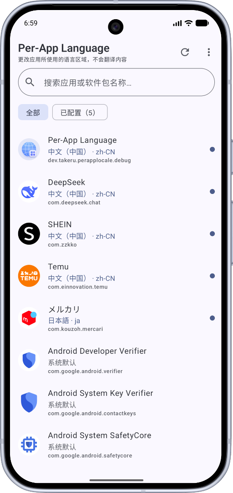

[作品介绍 · 全部项目](https://takeruf.com/zh/work)

# 我的作品

我是 Takeru，一名在东京的学生开发者和产品创作者。我开发 Web、移动端和 Mac 应用，也通过 MCP 将 AI 连接到日常使用的服务。

以下精选对中文用户有实际用途的应用和开源项目，根据截至 **2026 年 11 月 19 日**的公开项目与发行信息整理。

## Token Meter

一款原生 macOS 用量查看工具，将 Claude Code、Codex 和 Copilot CLI 的本地会话数据汇总到菜单栏、仪表盘与桌面小组件。支持按日期和模型统计用量；小组件支持 Claude Code 和 Codex，菜单栏与弹出面板可分别选择显示哪些服务。

用量限制信息以服务实际提供的数据为准：Codex 可显示日志中报告的额度；Claude 套餐用量需主动开启 OAuth 查询；Copilot CLI 不显示本地无法取得的剩余额度。

**支持平台：** macOS 14 及以上 · Apple Silicon / Intel。Windows 版开发已冻结，不再提供发行、更新或支持。

  
  

[产品介绍](https://takeruf.com/zh/projects/token-meter) · [macOS 下载](https://github.com/TakeruF/token_meter/releases/latest) · [中文说明](https://github.com/TakeruF/token_meter/blob/main/README.zh-CN.md) · [源代码](https://github.com/TakeruF/token_meter)

## anDrop

让 Mac 通过手机、平板自带的**互传联盟**功能或**华为分享**双向收发文件。手机端无需额外安装应用或登录账号；两端开启蓝牙，并连接同一 Wi-Fi（同一局域网）即可使用。

支持 Finder 共享、向多台设备分别发送、受信任设备管理和自动更新。还可通过 Finder 的“服务 → 通过 anDrop 发送原始文件”发送原始照片和视频，保留文件内的拍摄日期与位置信息。兼容性取决于机型和系统版本，具体已测范围请查看项目文档。

**支持平台：** macOS 14 及以上 · Apple Silicon

  

[产品介绍](https://takeruf.com/zh/projects/androp) · [Mac 下载](https://github.com/TakeruF/androp/releases/latest) · [使用说明与源代码](https://github.com/TakeruF/androp) · [兼容性记录](https://github.com/TakeruF/androp/blob/main/docs/compatibility.md)

## 应用语言切换器

一款免费开源的 Android 工具，无需 Root，通过 Shizuku 为不同应用设置不同的显示语言。即使应用没有出现在系统的“应用语言”页面中，也可以尝试设置；实际显示效果取决于应用是否提供对应语言资源。

**支持平台：** Android 13 及以上版本（需要 Shizuku）

  

  

目前通过 GitHub 下载，Google Play 版尚未公开发布。从 1.0.4 及更早版本迁移时，新旧版会作为独立应用安装，需要重新授予 Shizuku 权限；已经为其他应用设置的语言会保留。详见中文说明中的迁移步骤。

[中文说明](https://github.com/TakeruF/android-perapp-language-selector/blob/main/README.zh-CN.md) · [下载与发行记录](https://github.com/TakeruF/android-perapp-language-selector/releases/latest) · [源代码](https://github.com/TakeruF/android-perapp-language-selector)

## InApp Alt Tab

一款小巧的 Mac 菜单栏工具，用 **Option + Tab** 切换当前应用的窗口，**Option + Shift + Tab** 反向切换。适合同时打开多份 Word 文档等场景，也支持跨桌面与全屏窗口切换。

需要辅助功能权限，无需屏幕录制权限，不进行网络通信。发行版已使用 Developer ID 签名并通过 Apple 公证。

**支持平台：** macOS 13 及以上 · Apple Silicon / Intel

  

[产品介绍](https://takeruf.com/zh/projects/inapp-alt-tab) · [Mac 下载](https://github.com/TakeruF/inapp-alt-tab/releases/latest) · [使用说明与源代码](https://github.com/TakeruF/inapp-alt-tab)

## Nagi Browser

面向 Android 平板和手机的工作空间浏览器。用 Spaces、固定标签和收藏整理网页，通过命令栏搜索、打开网址或切换标签；宽屏可调整双栏分屏，窄屏使用底部导航与标签面板。

支持广告与跟踪器拦截、阅读模式、独立的无痕浏览、视频画中画，以及下载语言模型后在设备端翻译网页。界面支持简体中文等六种语言，也适配触摸、鼠标、触控板和实体键盘。

**支持平台：** Android 8.0 及以上。正式版通过 **Google Play** 安装和更新。

  

[产品介绍](https://takeruf.com/zh/projects/nagi) · [Google Play](https://play.google.com/store/apps/details?id=com.takeruf.nagi) · [使用说明与源代码](https://github.com/TakeruF/android-tab-browser)

## 开源项目 / MCP

- **[China Rail MCP](https://github.com/TakeruF/china-rail-mcp)**：将 12306 的车站、车次、时刻、参考票价、余票和经停站查询接入 AI 客户端。提供本地插件安装及远程部署说明；无需 12306 账号或 Cookie，不提供订票或支付功能。
- **[Japan Rail MCP](https://github.com/TakeruF/japan-rail-mcp)**：以新干线为重点的只读 MCP 服务器。无需凭据即可查询车站目录；配置 Ekispert API 密钥后可查询直达列车时刻、票价、席别和经停站。不提供余票库存或换乘路线查询。
- **[Waseda Portal MCP](https://github.com/TakeruF/waseda-portal-mcp)**：非官方的早稻田大学信息工具，可查询公开课程大纲与学事日程；本人在本地登录后，还可只读查看 Moodle 课程、作业期限及 MyWaseda 停课与变更信息。公开模式不访问个人账号数据。
- **[MCP Mail Core](https://github.com/TakeruF/mcp-mail-core)**：支持独立授权 Gmail 账户的多账户邮件 MCP 核心，并为 Gmail、QQ 邮箱和 iCloud 邮箱的独立集成提供统一接口。跨账户读取保留来源，写入需要明确账户与确认。
- **[Silkroad MCP](https://github.com/TakeruF/silkroad-mcp)**：面向亚洲服务、设备和标准协议的 MCP 项目目录，包含可复用组件、蓝图与模板。

## 关于我

[GitHub 主页](https://github.com/TakeruF) · [完整作品集](https://takeruf.com/zh/work)
